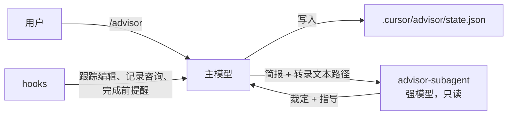

# Advisor

Advisor 让 Cursor 的 agent 可以在关键时刻咨询一个更强的第二模型：在做出重大决策之前、在卡在某个错误上时，以及在宣布任务完成之前。主模型继续负责干活；advisor 读取一份完整的简报（在可用时还会读取对话转录文本），深入思考，并返回一个带有具体指导的裁定。你在复杂任务上获得更高的质量，同时只在真正重要的地方为强模型付费。

默认的 advisor 是推理强度调到最高的最新 Grok（Grok 4.6）。由于 advisor 是一个拥有自己模型的 subagent，它不必和你正在聊天的模型相同：任何对 subagent 可用的模型都可以，因此第二意见可以来自不同的模型家族。

## Installation

```bash
/add-plugin advisor
```

## Quick start

```text
/advisor                     使用默认 advisor 开启（Grok 4.6，xhigh 推理强度）
/advisor composer-2.5        使用其他模型开启（任意 subagent 模型 slug）
/advisor ask 这个迁移可以安全地运行两次吗？
/advisor status
/advisor off
```

然后照常工作。当 agent 遇到检查点时，它会咨询 advisor，并用一两句话汇报结果：

```text
Advisor（cursor-grok-4.6-xhigh）：继续推进修改。retry 包装器掩盖了真正的
失败原因；这个 401 来自过期的 token 缓存。已移除 retry，修复了缓存键。
```

要让该 skill 在整个会话中保持在上下文里，请使用 Option+Enter（macOS）或 Alt+Enter（Windows/Linux）调用 `/advisor`，将其作为 Custom Mode 运行。无论哪种方式，状态文件都有效。

## How it works



- **Skill `advisor`** 实现 `/advisor` 命令和检查点协议：何时咨询、如何撰写简报、如何根据裁定采取行动，以及如何汇报。参见 [skills/advisor/SKILL.md](skills/advisor/SKILL.md) 和[简报模板](skills/advisor/references/briefing-template.md)。
- **Agent `advisor-subagent`** 是一个绑定到强模型的只读 subagent（默认 `grok-4.6[effort=xhigh]`，可通过 `/advisor <model>` 按会话覆盖）。它会根据仓库核对简报，在路径可用时读取转录文本，并以 `Verdict / Why / Recommendations / Risks / Answers / Confidence` 作答。
- **Hooks** 在不增加噪音的前提下保证该模式不被绕过：`afterFileEdit` 记录自上次咨询以来文件是否发生变化，`subagentStop` 统计每次咨询并将建议追加到 `.cursor/advisor/log.md`，`stop` 会在一轮对话以未审阅的改动结束时发布一行 `[Advisor]` 后续提醒，以免跳过完成前的咨询。该提醒每批改动最多触发一次；当 agent 以向你提问结束本轮时保持沉默；并可通过 `/advisor nudge off` 关闭。

## Checkpoints

| 检查点 | 触发条件 |
| --- | --- |
| 重大决策 | 在多种方案之间选择；迁移、删除、公开 API 或配置变更、依赖替换、认证或支付代码；请求模糊到足以改变工作方向。 |
| 卡住 | 两次实际尝试后仍出现相同错误或测试失败；无法解释的行为；即将添加 workaround（retry 循环、`sleep`、范围过宽的 `try/except`、跳过的测试、禁用的检查）。 |
| 宣布完成前 | 任何改动了逻辑或涉及两个以上文件的任务。琐碎的改动会被跳过，并明确说明。 |
| 按需 | `/advisor ask ...`，或询问 advisor 的看法。 |

该 skill 将每个任务的咨询次数限制在大约四次，并且从不为常规步骤或 agent 可以自行验证的事情进行咨询。

## Models

默认是推理强度最高的最新 Grok 模型（目前为 `cursor-grok-4.6-xhigh`）。`/advisor <model>` 接受任何对 subagent 可用的模型 slug；诸如 `grok fast` 或 `composer` 这样的家族名称会解析为该家族推理层级最高的最新模型。如果 Cursor 拒绝了某个 slug，该 skill 会从错误信息中挑选最接近的有效模型，保存并告知你。团队模型限制和套餐额度对 advisor 与对任何 subagent 一样适用。

## State

所有内容都位于项目根目录的 `.cursor/advisor/` 中，可随时安全删除：

| 文件 | 用途 |
| --- | --- |
| `state.json` | 模式、模型、提醒设置、咨询次数、绑定的会话、转录文本路径。 |
| `log.md` | 每次已完成的咨询及其裁定，供日后回顾。 |
| `pending` | 标记：自上次咨询以来文件发生了变化。 |
| `last-response.txt` | 最新回复的末尾部分，用于避免在向你提问时触发提醒。 |

如果不想让 `.cursor/advisor/` 进入仓库，请将其加入 `.gitignore`；该 skill 从不将其暂存（stage）。

## Cost

每次咨询都是对 advisor 模型的一次调用，附带一份几千 token 的简报，加上 advisor 选择读取的任何内容。关键在于有选择地使用：一个典型功能需要一到三次咨询。默认 advisor Grok 4.6 从 Cursor Models 用量池中扣费，因此是强模型中成本最低的；当你想要不同家族的视角时，可以切换模型。

## Limitations

- 状态是按项目划分的，并绑定到启用它的会话。在同一项目的另一个会话中运行 `/advisor` 会将该模式重新绑定到那里（模型和提醒设置会延续；咨询历史和 advisor 上下文则重新开始）。使用 `/advisor status` 可以在不重新绑定的情况下查看。
- 转录文本路径由 hooks 记录，因此只有在 hooks 运行且转录功能启用时，advisor 才会读取完整转录文本。它始终会收到简报。
- 回合结束时的提醒依赖于 plugin 的 hooks；在 hooks 不运行的地方，该 skill 仍会自行执行完成前的咨询。

## License

MIT
