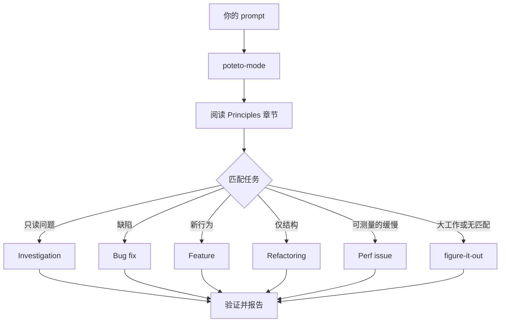

# 通过 `/poteto-mode` 路由工作

`/poteto-mode` 是前门。你给它一个目标，它匹配二十二个 playbook 中的一个，把该 playbook 的步骤复制到待办列表中，并在步骤需要时调用其他技能。在本页中，你将了解一个好的 prompt 是什么样的，以及实际上你只需要其中很少的一部分。


## 你的 prompt 会发生什么



该图展示的是常见路由。此外还有一些 playbook，用于：攀升某个指标、诊断运行时症状和捕获的跟踪记录、原型制作、视觉一致性、编写和评估技能、自主运行、开启 PR、照看 PR 或技术栈直到可合并、发布已验证的技术栈、自动运行 PR 队列或技术栈、会话接续、安全暂停、多阶段计划，以及 worktree 清理。[playbook 目录](../../skills/poteto-mode/playbooks/)中有完整集合。

## 说出目标，而非繁文缛节

你不需要写规格说明。你只需说出哪里出了问题或你想要什么，再加上任何你已经知道的、能为 agent 节省时间的信息：

```text
/poteto-mode users get two notifications after a retry. repro first, then fix and verify.
```

这是一个 Bug fix prompt。"repro first"是一项真实的约束，而非客套，playbook 会尊重它。看着待办列表被 Bug fix 的步骤填满。

## prompt 中应包含什么

一个有用的 prompt 最多包含五样东西，每样都能用一句话说清：

- **目标。** 说出哪里出了问题，或者你想要什么。
- **完成判定。** 它必须能通过或失败。"Make it better"和"work on it for an hour"都不是判定。
- **你想看到的证据。** 要求提供真实的命令输出、流程视频、存储的值，或前后对比的数字。
- **你已经知道的信息。** 一个症状、一条复现步骤、一行日志或一个链接，都能为 agent 省去一次搜索。
- **真实的约束。** "repro first"、"don't change any code yet"、"zero behavior change"和"let me review before proceeding"，每一条都会改变 agent 的行为。

这里是一个包含全部五项的 prompt：

```text
/poteto-mode the csv export drops its last row since yesterday's deploy. failing job id is 4812. repro first, then fix. done means the 60k-row fixture exports every row. show me the row counts before and after.
```

有两样东西值得省略：

- **怎么做。** 说出要达成什么，给 agent 留出空间，让它找到比你会选择的更好的路径。技能列表也是如此，见下面的陷阱。
- **你起初对原因的猜测。** 说出的猜测会把搜索范围缩小到你所指的地方。先让 agent 复述问题，再分享你的预感。

对于嘈杂的报告，例如很长的帖子或模糊的 bug，把复述作为第一步：

```text
/poteto-mode read this thread. restate the underlying issue in your own words, in plain english. don't change any code yet.
```

误读会在复述中显现，早于任何代码产生。在那里纠正它，代价只是一条消息，而不是一次错误的修复。仅做复述、不使用 playbook 时，运行 [`/in-your-own-words`](../../skills/in-your-own-words/SKILL.md)。它会复述 agent 认为你的目标是什么，以及你想解决什么问题。

当你不确定一个 prompt 是否瞄准了方向时，在发送前对它运行 [`/sharpen`](../../skills/sharpen/SKILL.md)：

```text
/sharpen write a migration guide for the v2 config format.
```

agent 会说出顶尖专业人士会做而你没要求的事、他们会入手的最原始素材、他们会使用的方法和工具，以及除你或 agent 之外还有什么能表明结果是对的。然后它重写你的 prompt，以准确地要求这些，更深但不更大。该重写会要求 agent 对任何实验能决定的选择做原型，并根据观察到的情况推荐一个选项，而把产品和偏好选择留给你。它不会做这个任务。阅读重写后的内容，然后发送它，例如用 `/poteto-mode`。

当你说不清自己想要什么时，先对你自己的描述和文件运行 [`/reframe`](../../skills/reframe/SKILL.md)：

```text
/reframe the settings page saves some fields right away and others only on submit, and people lose edits.
```

agent 会给出 8 到 12 个专家术语，按每个术语会多大程度改变你所构建的东西来排序。每个术语都附带你所描述内容中被它命名的部分、一个使用该术语的真实项目（链接经过核验），以及它能让你向 agent 要求什么。它还会借用 2 到 3 个邻近领域中用其他名字解决同一问题的术语，并说明每个类比的失效之处。然后它用这些新词重写你的描述。发送该重写内容，或对它运行 `/sharpen`。

## 简短地跟进

当对话中已经带有上下文时，prompt 会缩到几乎为空。下面这些都足够：

```text
/poteto-mode do it
```

```text
continue
```

```text
keep going until done
```

简短之所以有效，是因为 playbook 承载了结构，而 Custom Mode 让 `/poteto-mode` 在每一轮都处于上下文中。[设置 pstack](./01-setup.md#run-your-first-task)展示了如何启动一个。你的话承载意图，技能承载严谨。

## 用"new task"切换任务

一次长对话会累积上一个任务的上下文。当你切换主题时，明确说出来：

```text
/poteto-mode new task. figure out why the cache entry survives logout. don't change any code yet.
```

"new task"告诉 `/poteto-mode` 重新匹配，而不是继续之前的 playbook。"don't change any code yet"把这一轮锁定在 Investigation 上。没有这两个短语，一个处于 Feature 中途的模式往往会把你的问题当作下一个功能步骤。

## 让并行工作各用一台机器

如果你在一台电脑上对同一个仓库运行多个 agent，它们会争抢工作树、端口和构建输出。最干净的隔离方式是[云端子 agent](https://cursor.com/docs/subagents#cloud-subagents)。每一个都有自己的 VM 和分支，因此它可以安装依赖、运行你的应用，并记录结果的视频，而不触及你的机器。在任务前输入 `/in-cloud`，或让父对话把工作交给云端子 agent。

当工作必须留在本地时，一开始就要求一个 worktree：

```text
/poteto-mode new task. branch off <base> in a fresh worktree, then port the parser change there.
```

每个任务都在自己的分支和 worktree 中，意味着没有 agent 会覆盖别人的文件。worktree 会消耗磁盘和机器资源，所以一台笔记本电脑一次只能运行少数几个。[开启 PR 的 playbook](../../skills/poteto-mode/playbooks/opening-a-pr.md)已经针对代码更改在 worktree 中工作，因此通常只有在某个特定的 base 或位置很重要时，你才需要这么说。

worktree 会不断累积。当磁盘空间紧张时，可以这样问：

```text
/poteto-mode what's eating my disk? prune the worktrees that are safe to prune.
```

[Worktree 清理 playbook](../../skills/poteto-mode/playbooks/worktree-cleanup.md)会根据合并状态、未提交的工作以及哪些对话仍在触及它，对每个 worktree 进行分类。它只删除那些证据表明确认安全的对象，并对任何持有未提交工作的对象暂停下来等待你的决定。

## 让它持续运行

当你离开时，说出什么算完成，然后走开：

```text
/poteto-mode im stepping away. keep going until the migration check reports zero old callers. log your decisions.
```

你稍后要审阅的工作会路由到 [`/figure-it-out`](../../skills/figure-it-out/SKILL.md)，它会设计这次运行的阶段，并保留一份 [`/show-me-your-work`](../../skills/show-me-your-work/SKILL.md) 决策日志。[让你睡觉时也能运行工作](./07-overnight.md)涵盖了完整的夜间契约。

**陷阱：** 不要在 prompt 中列举技能（"use /architect, then /arena, then /interrogate..."）。playbook 已经对它们做了排序，手写的顺序通常会重排或遗漏 playbook 本会保留的步骤。只有当你想覆盖某个特定选择时，才点名某个技能。

阅读 [`poteto-mode`](../../skills/poteto-mode/SKILL.md) 本身，了解完整的路由规则。

下一步：[理解代码](./03-understand.md)。
