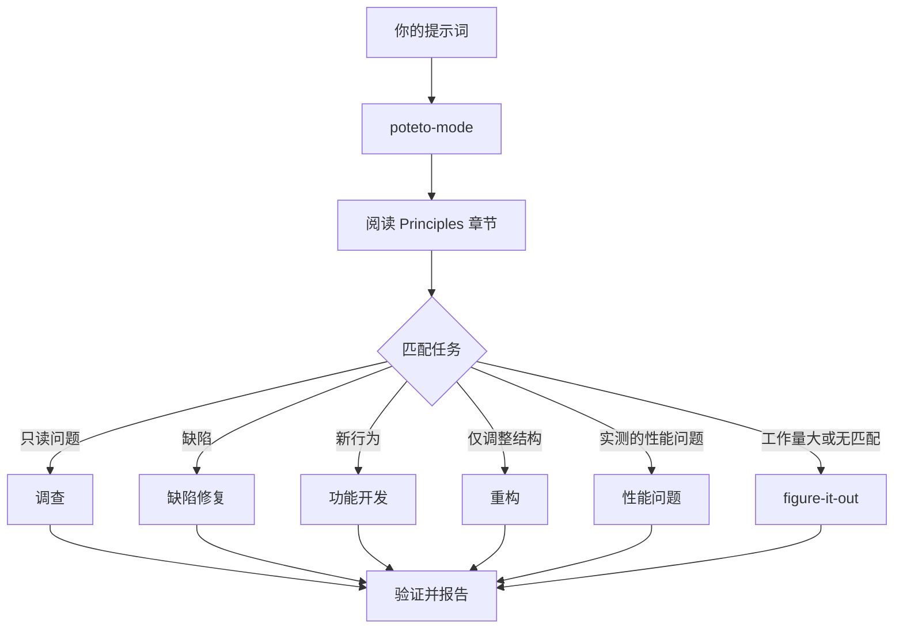

# 通过 `/poteto-mode` 分派工作

`/poteto-mode` 是入口。你给它一个目标，它从 22 个行动手册中匹配一个，把该行动手册的步骤复制进待办清单，并在步骤需要时调用其他技能。在本页中，你会了解一个好的提示词长什么样，以及你其实只需要写多少。


## 你的提示词会发生什么



这张图展示的是常见路线。此外还有一些行动手册，用于爬山法优化某个指标、诊断运行时症状和抓取的追踪记录、原型、视觉一致性、编写与评估技能、自主运行、开 PR、照看 PR 或栈直到可合并、发布已验证的栈、让 PR 队列或栈自动运行、接续会话、安全暂停、多阶段计划，以及工作树清理。[行动手册目录](../../skills/poteto-mode/playbooks/)收录了完整清单。

## 说清目标，别讲繁文缛节

你不用写规格说明书。只要说出哪里不对、或者你想要什么，再加上任何你已经知道、能帮智能体省时间的信息：

```text
/poteto-mode 用户重试后会收到两条通知。先复现，然后修复并验证。
```

这是一条缺陷修复提示词。"先复现"是实打实的约束，不是客套，行动手册会照办。看待办清单里填进缺陷修复的各个步骤。

## 提示词里该写什么

一条有用的提示词最多包含五样东西，每样一句话就能说清：

- **目标。** 说出哪里不对，或者你想要什么。
- **完成校验。** 它必须能判定通过或失败。"做得更好"和"搞一小时"都不算校验。
- **你想看到的证据。** 可以要求真实的命令输出、操作流程的录屏、存下来的值，或者前后对比的数字。
- **你已经知道的信息。** 一个症状、一步复现操作、一行日志或者一个链接，都能省掉智能体一次搜索。
- **真正的约束。**"先复现""先别改任何代码""行为零变化""动手前让我评审"——每一条都会改变智能体的做法。

下面是一条五样俱全的提示词：

```text
/poteto-mode 从昨天的部署起，csv 导出会丢掉最后一行。失败的 job id 是 4812。先复现，然后修复。完成的标准是 6 万行的测试样本能导出每一行。把前后的行数拿给我看。
```

有两样东西值得省略：

- **怎么做。** 只说要达成什么，给智能体留余地，让它找到比你要选的路更好的走法。列一堆技能也一样，下面的常见误区会讲到。
- **一开始别讲你的原因猜想。** 先把猜测说出口，搜索范围就被框在你指的那个方向。让智能体先复述问题，你再说出自己的直觉。

如果报告很杂乱，比如一长串讨论帖或者一个模糊的 bug，就把复述作为第一步：

```text
/poteto-mode 读一下这段讨论。用你自己的话、用大白话把真正的问题复述一遍。先别改任何代码。
```

理解错了会在复述里暴露出来，那时还没有写出任何代码。在那里纠正，代价只是一条消息，而不是一次错误的修复。只想复述、不跑行动手册的话，用 [`/in-your-own-words`](../../skills/in-your-own-words/SKILL.md)。它会复述智能体理解的目标，以及你想解决的问题。

拿不准提示词有没有对准目标时，先拿它跑一遍 [`/sharpen`](../../skills/sharpen/SKILL.md) 再发出去：

```text
/sharpen 写一份 v2 配置格式的迁移指南。
```

智能体会说出：顶尖专业人士会做、而你没要求的事，他们会从哪份最原始的材料入手，会用什么方法和工具，以及除你或智能体之外，还有什么能证明结果是对的。然后它改写你的提示词，正好把这些要求写进去——更深，但不更大。改写后的提示词会要求智能体：凡实验能定的选择就先做原型，并根据观察到的结果推荐一个选项；而产品和偏好上的取舍留给你。它不会替你做任务。看一下改写结果，再发出去，比如用 `/poteto-mode` 发。

当你说不清自己到底想要什么时，先拿你自己的描述和文件跑一遍 [`/reframe`](../../skills/reframe/SKILL.md)：

```text
/reframe 设置页有些字段立刻保存，有些只在提交时保存，用户因此丢了编辑内容。
```

智能体会给出 8 到 12 个专业说法，按每个说法会多大程度改变你要做的东西排序。每个说法都附上：它对应你描述里的哪一部分、一个真正在用它的项目（链接已核对），以及它能让你向智能体提什么要求。它还会从 2 到 3 个相邻领域借用术语——那些领域用别的名字解决过同一个问题——并说明每种类比在哪里失效。然后它用这些新词改写你的描述。把改写结果发出去，或者再拿它跑一遍 `/sharpen`。

## 简短跟进

当对话里已经有上下文时，提示词可以短到几乎没有了。下面这些就够了：

```text
/poteto-mode 做吧
```

```text
继续
```

```text
一直做，直到完成
```

短指令能奏效，是因为行动手册提供了结构，而自定义模式让 `/poteto-mode` 在每一轮对话里都保持在上下文中。[配置 pstack](./01-setup.md#run-your-first-task) 演示了怎么建一个。你的话负责传达意图，技能负责保证严谨。

## 用 "new task" 切换任务

一段长对话会累积上一个任务的上下文。换话题时要明说：

```text
/poteto-mode new task. 查清楚缓存项为什么在退出登录后还留着。先别改任何代码。
```

"new task" 会告诉 `/poteto-mode` 重新匹配，而不是接着上一个行动手册。"先别改任何代码"把这次锁定在调查上。没有这两句话，处在功能开发中途的模式往往会把你的问题当成下一步的功能操作。

## 给并行任务配一台单独的机器

如果你在一台电脑上让多个智能体操作同一个代码仓库，它们会争抢工作树、端口和构建产物。最干净的隔离方式是[云端子代理](https://cursor.com/docs/subagents#cloud-subagents)。每个云端子代理都有各自的虚拟机和分支，因此可以安装依赖、运行你的应用、录下结果，而不碰你的机器。在任务前输入 `/in-cloud`，或者让父级对话把工作交给云端子代理。

当工作必须留在本地时，一开始就要求建个工作树：

```text
/poteto-mode new task. 在一个新工作树里基于 <base> 开个分支，然后把解析器的改动移植过去。
```

每个任务各用自己的分支和工作树，就不会有智能体覆盖别人的文件。工作树会占用磁盘和机器资源，所以笔记本同时只能跑几个。[开 PR 行动手册](../../skills/poteto-mode/playbooks/opening-a-pr.md) 本身就会在代码改动时使用工作树，所以通常只有在乎特定的基线或位置时才需要这么说。

工作树会越攒越多。磁盘吃紧时，可以这样问：

```text
/poteto-mode 我的磁盘被什么占了？把能安全清理的工作树清掉。
```

[工作树清理行动手册](../../skills/poteto-mode/playbooks/worktree-cleanup.md) 会按合并状态、未提交的工作，以及还有哪些对话在用它，给每个工作树分类。它只删除这些证据确认安全的部分；凡是还有未提交工作的，都会停下来等你的决定。

## 让它一直跑

要离开时，把完成的标准说清楚，然后走人：

```text
/poteto-mode 我要离开了。一直做到迁移检查显示旧调用方为零。把你的决策记录下来。
```

你稍后才评审的工作会走 [`/figure-it-out`](../../skills/figure-it-out/SKILL.md)，它会设计这次运行的各个阶段，并维护一份 [`/show-me-your-work`](../../skills/show-me-your-work/SKILL.md) 决策日志。[睡觉时跑任务](./07-overnight.md) 讲了完整的夜间运行约定。

**常见误区：** 别在提示词里罗列技能（"用 /architect，再用 /arena，再用 /interrogate……"）。行动手册已经排好了顺序，手写顺序往往会打乱或漏掉行动手册本会保留的步骤。只有想覆盖某个具体选择时，才点名某个技能。

完整的路由规则请读 [`poteto-mode`](../../skills/poteto-mode/SKILL.md) 本身。

下一篇：[理解代码](./03-understand.md)。
