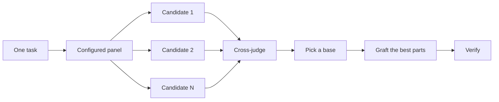

# 先设计，再写代码

对一道难题只做一次尝试，会把模型想到的第一个形态锁定下来。`/architect` 在实现之前先把类型和边界确定下来。`/arena` 针对同一份需求跑多次尝试，并把最好的部分合并起来。`/interrogate` 让其他模型试着攻破结果。当任务追求的是覆盖面而非设计综合时，`/swarm` 会把切片或竞赛并行展开，并聚合它们的结果。

最常见的两个设计错误是：直接采用 agent 的第一个设计，以及打磨一个还没有任何代码验证过的计划。本页把这两个问题都解决掉。你要通过代码来规划。原型用来回答悬而未决的问题，一份 README 或教程用来设定目标，而书面计划放在最后。


## 用 `/architect` 确定形态

```text
/architect design the import pipeline before writing any code. i care most about how callers use it.
```

[`/architect`](../../skills/architect/SKILL.md) 会先追踪这次改动触及的每一个系统。然后它会勾勒出两种不同的形态，每种都带有类型、签名和模块边界，并挑选出这样的一个：每一处状态都有唯一的所有者，每一项任务都只有一种做法，调用方需要了解的东西最少。对于大型或存在争议的设计，它会改为运行 `/arena`，而不是独自勾勒。如果你想在写任何代码之前先看到设计，就在提示里说明。

代码开始写之后，设计并非不可更改。如果同一个变通办法反复出现，`/architect` 会重新设计，而不是在它周围打补丁。

## 用 `/arena` 展开多次尝试

```text
/arena take my prompt to the arena verbatim. i want to compare their proposals with yours.
```

[`/arena`](../../skills/arena/SKILL.md) 是底层的通用工具。N 个子 agent 并行地尝试同一份设计或代码需求，各自写入自己的工作树或目录。一位来自不同模型厂商的只读裁判依据评分标准给每个候选打分。当没有其他厂商的模型可用时，协调者会跳过裁判，自行挑选基础方案。协调者会从头到尾读完每个候选，选出一个基础方案，把落选者中最好的想法嫁接进来，然后验证结果。



评审团来自你的 [`/setup-pstack`](../../skills/setup-pstack/SKILL.md) 配置，你可以按任务调整它。当决策很重要时，要求更多候选；不重要时，要求更少：

```text
/arena this, 5 candidates. the cache key format is expensive to change later.
```

## 用 `/swarm` 覆盖切片与竞赛

```text
/swarm check every package under packages/ against its check.sh. one worker per package. one report.
```

[`/swarm`](../../skills/swarm/SKILL.md) 把 N 个 worker 分散到独立的切片、覆盖矩阵、考验赛道、探索分区或预先声明的竞赛分支上。每个 worker 都有自己的范围和检查项，然后报告 `PASS`、`ISSUES` 或 `BLOCKED`。父级等待所有 worker，并返回一份紧凑的报告，带上有任何缺口或掉队情况。

当并行能换来覆盖面，或能让独立的检查相互竞赛时，就用它。`/arena` 给每个 worker 相同的设计或代码需求，然后选出一个基础方案并嫁接最好的部分。`/swarm` 覆盖切片，或按预先声明的选择规则跑一场竞赛。它不使用选基和嫁接那套仪式。

## 用 `/interrogate` 攻破它

```text
/interrogate the whole branch, but skeptically. no nitpicks unless it's an actual bug or regression.
```

[`/interrogate`](../../skills/interrogate/SKILL.md) 把改动及其意图交给已配置模型上的对手，每个对手都试着用针对真实代码的一次运行来攻破它。不同的对手会发现不同的失败。只有当重新运行其命令显示出一个破坏意图的失败时，一条发现才会保留下来。报告会列出每一条经过验证的发现以及发现它的对手，然后列出每个对手丢弃了什么以及原因，并且不做任何应用。

也要读一读 Dropped 列表。你可以推翻判定。

## 用原型代替争论

永远不要采用第一个设计。多要几个，然后根据你能看到的证据来挑选：

```text
/poteto-mode prototype a few options for the new dropdown menu. take screenshots or videos for me to compare.
```

[Prototype playbook](../../skills/poteto-mode/playbooks/prototype.md) 会在临时目录里构建一次性的草图，把各个变体放在一个切换器后面，逐个驱动，并截取截图或耗时。它同样适用于行为和算法，而不仅仅是 UI。原型就是用代码做规划。它让 agent 通过运行点什么来回答自己的开放问题，而不是来问你，并且为那些你本来想不到的选项留出空间。

同样的思路可以放大到一个真正的设计上。把 `/architect` 和原型搭配起来，并保留一道评审关卡：

```text
/poteto-mode we need rate limiting for external webhooks. /architect it first, and answer open questions with prototypes. let me review before proceeding.
```

不要把对手用在抽象计划上。`/interrogate` 会丢弃任何没有被一次运行所证实的发现，所以一个背后没有代码的计划几乎没什么可供它们攻破的。让原型把问题解决掉，然后评审真正做出来的东西。

## 对共享代码先写 README

对于一个会被其他代码使用的包或 API，先从用户会读的文档开始：

```text
/poteto-mode write a tutorial for how i would use the new config package first. then /teach me why it beats the current one.
```

先写教程会迫使你站在调用方的视角。你向一个假想的用户描述 API，再倒推回实现。这份文档也会变成一个具体的目标，agent 可以据此核对自己的工作。当文档本身很重要时，要点名 [`/technical-writing`](../../skills/technical-writing/SKILL.md)，这样教程才会保持为教程，而不会同时漂移成参考文档和说明。

## 设计确定后再做计划

pstack 故意没有规划技能。当你确实想要一份书面计划时，等设计确定后再要求它：

```text
/poteto-mode turn this design into a plan. small verifiable PRs, each with its own verification steps.
```

[Multi-phase plan playbook](../../skills/poteto-mode/playbooks/multi-phase-plan.md) 会先用原型解决任何剩余的开放问题，然后为每个 PR 写一节，每节都以改动可行的证据收尾。仅仅一套通过的测试不算这样的证据。计划本身就是交付物。该 playbook 不会实现它，只有你说开始才会启动执行。

对于一次迁移，要在提示里说明标准：

```text
/poteto-mode plan the migration of our ui library to the new styling system. small verifiable PRs, each with visual regression checks. the result must match the original exactly, bugs included.
```

“bugs included”（连 bug 一起保留）能防止迁移过程中悄悄修好一些东西，否则新旧输出就无法比较了。对于一个跨越多天的项目，你可以把计划提交到仓库里一段时间，让其他 agent 看到正在进行的工作。工作落地后把它删掉。

## 一个任务该投入多少设计工作？

你可能会想，是不是每次改动都需要这些。不需要。大多数改动都不需要。大致有个阶梯：

- 一个你自己拿不准的、小而完整的改动，只需要 `/interrogate`。
- 一个跨越函数边界或转移所有权的改动，值得用 `/architect`，当设计庞大或有争议时，它会带上 `/arena`。
- 一个独立的决策，如果靠独立尝试会有帮助，比如命名、格式或某个算法，直接用 `/arena`。
- 一个覆盖矩阵、一组并行检查，或带预先声明分支的竞赛，用 `/swarm`。
- 一个可以通过运行点什么来回答的开放问题，比如布局、耗时或某种方法，用原型，而不是争论。
- 一个有争议且难以逆转的设计，用 `/architect`，然后在发布前用 `/interrogate`。
- 跨多个 PR 的工作，要有一份计划，且在设计确定之后再写。

`/poteto-mode` 已经应用了这个阶梯。跨界的工作会自行触发 `/architect`，所以你主要在想要比默认更多或更少的审视时，才直接动用这些。

下一步：[构建并清理改动](./05-build-and-clean.md)。
