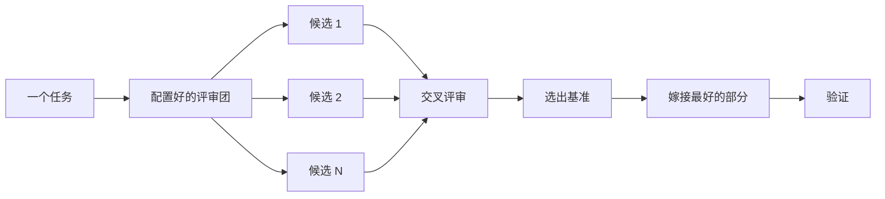

# 写代码前先做设计

对难题只做一次设计，就会把模型最先想到的那个形态定死。`/architect` 在实现前先把类型和边界确定下来。`/arena` 针对同一份需求做多轮尝试，再把最好的部分合并起来。`/interrogate` 让其他模型想办法搞垮这个结果。当任务追求的是覆盖面而不是设计综合时，就用 `/swarm` 把各个分片或竞速铺开，再汇总它们的结果。

最常见的两个设计错误，一是直接采用智能体给出的第一个设计，二是打磨一个根本没有代码验证过的计划。本页把这两个问题都解决掉。你要用代码来规划。原型来回答悬而未决的问题，README 或教程来设定目标，书面计划放到最后。


## 用 `/architect` 确定形态

```text
/architect 在写任何代码之前先设计导入流水线。我最关心的是调用方怎么用它。
```

[`/architect`](../../skills/architect/SKILL.md) 会先追踪这次改动触及的每一个系统。然后它会勾勒出两种不同的形态，每种都带上类型、签名和模块边界，并挑出那个每一份状态都有唯一归属、每件事都有唯一做法、而调用方需要了解最少的方案。对于规模较大或存在争议的设计，它会运行 `/arena`，而不是独自勾画。如果你想在写代码前先看看设计，就在提示词里说明。

代码一旦开始写，设计就不是不可改的了。如果同一个权宜之计反复出现，`/architect` 会重新设计，而不是围着它打补丁。

## 用 `/arena` 铺开多轮尝试

```text
/arena 把我的提示词原样带到竞技场。我想把他们的方案和你的方案对比一下。
```

[`/arena`](../../skills/arena/SKILL.md) 是底层的通用工具。N 个子代理并行尝试同一份设计或代码需求，各自写入自己的工作树或目录。一位来自不同模型厂商的只读评审按评分标准给每个候选打分。当没有其他厂商的模型可用时，协调者会跳过评审，自己选出基准方案。协调者会把每个候选从头到尾读一遍，选出一个基准，把落选方案里最好的想法嫁接进来，再验证结果。



评审团来自你 [`/setup-pstack`](../../skills/setup-pstack/SKILL.md) 的配置，你可以按任务调整它。决策重要时就要更多候选，不重要时少一些：

```text
/arena 这个任务，要 5 个候选。缓存键的格式以后改起来代价很大。
```

## 用 `/swarm` 覆盖分片和竞速

```text
/swarm 检查 packages/ 下的每个包，用各自的 check.sh 来查。每个包一个执行单元。最后出一份报告。
```

[`/swarm`](../../skills/swarm/SKILL.md) 把 N 个执行单元铺开到独立的分片、覆盖矩阵、考验赛道、探索分区或预先声明的竞速分组上。每个执行单元都有自己的范围和校验，然后报告 `PASS`、`ISSUES` 或 `BLOCKED`。父级等待所有执行单元完成，返回一份紧凑的报告，列出其中的缺口或掉队情况。

当并行能换来覆盖面，或让独立的校验竞速时，就用它。`/arena` 给每个执行单元相同的设计或代码需求，然后选出一个基准并嫁接最好的部分。`/swarm` 覆盖分片，或按预先声明的选拔规则进行竞速。它不用选基准、嫁接那一套流程。

## 用 `/interrogate` 把它搞垮

```text
/interrogate 检查整个分支，但要带着怀疑的态度。除非是真正的 bug 或回归问题，否则别吹毛求疵。
```

[`/interrogate`](../../skills/interrogate/SKILL.md) 把改动及其意图交给配置好的模型上的对抗者，每个对抗者都试着用针对真实代码的运行把它搞垮。不同对抗者会发现不同的失败点。只有当重跑它的命令确实出现破坏意图的失败时，一条发现才会被保留。报告列出每一条经过验证的发现以及发现它的对抗者，接着列出每个对抗者丢弃的内容及原因，但不会应用任何改动。

也要读一读 Dropped 列表。你可以推翻这个结论。

## 用原型代替争论

别采用第一个设计。多要几个方案，然后根据你能看到的证据来挑选：

```text
/poteto-mode 给新的下拉菜单做几个选项的原型。截屏或录视频给我对比。
```

[原型行动手册](../../skills/poteto-mode/playbooks/prototype.md)会在临时目录里搭出一次性的草图，把各个变体放到一个切换器后面，逐个驱动，并截取屏幕截图或记录耗时。它不仅适用于 UI，也适用于行为和算法。原型就是用代码做规划。它让智能体通过跑点东西来回答自己的待解问题，而不是来问你，而且还能冒出一个你原本想不到的选项。

同样的思路可以放大到真正的设计上。把 `/architect` 和原型结合起来，并保留一道评审关卡：

```text
/poteto-mode 我们需要给外部 webhook 做限流。先用 /architect 设计，再用原型回答悬而未决的问题。继续之前让我先评审一下。
```

别把对抗者花在抽象计划上。`/interrogate` 会丢弃每一次运行都无法证实的发现，所以没有代码支撑的计划，几乎没什么可让它们搞垮的。先用原型把问题解决掉，再去评审做出来的东西。

## 对共享代码先写 README

对于会被其他代码使用的包或 API，先从用户会读的文档开始写：

```text
/poteto-mode 先写一份教程，讲我会怎么使用新的配置包。然后用 /teach 讲讲它为什么比现在的好。
```

先写教程会逼你站在调用方的视角。你向一个假想的用户描述 API，再倒推到实现。这份文档也会成为一个具体的目标，智能体可以拿它来对照检查自己的工作。当文档本身很重要时，点名 [`/technical-writing`](../../skills/technical-writing/SKILL.md)，这样教程就能保持是教程，而不会一下子跑偏成参考文档加讲解。

## 设计定下来之后再写计划

pstack 故意没有规划技能。当你确实想要一份书面计划时，等设计定下来后再要：

```text
/poteto-mode 把这个设计变成一份计划。拆成小的、可校验的 PR，每个 PR 都带上自己的验证步骤。
```

[多阶段计划行动手册](../../skills/poteto-mode/playbooks/multi-phase-plan.md)会先用原型解决剩下的待解问题，然后给每个 PR 写一节，每节都以证明改动有效收尾。光是测试套件通过还不算这个证明。计划本身就是交付物。行动手册不会去执行它，只有你说开始，执行才会启动。

对于迁移，要在提示词里把标准说清楚：

```text
/poteto-mode 规划把我们 UI 库迁移到新样式系统。拆成小的、可校验的 PR，每个都带上视觉回归检查。结果必须和原来完全一致，连 bug 也要照搬。
```

「连 bug 也要照搬」能防止迁移过程中顺手把问题修掉，否则新旧输出就没法对比了。对于跨越很多天的项目，你可以把计划先提交到仓库里一段时间，让其他智能体看到正在进行的工作。等工作落地后再删掉它。

## 一个任务值不值得做多少设计工作？

你可能会想，是不是每个改动都需要这些。不是。大多数改动根本用不上。大致有个梯度：

- 一个虽小、已完成但你没把握的改动，只用 `/interrogate` 就够了。
- 跨越函数边界或改变归属权的改动，值得上 `/architect`；当设计规模大或有争议时，还会带上 `/arena`。
- 一个独立的决策，如果多方独立尝试有帮助，比如命名、格式或算法，直接用 `/arena`。
- 覆盖矩阵、一组并行校验，或带预先声明分组的竞速，用 `/swarm`。
- 一个可以通过跑点东西来回答的待解问题，比如布局、耗时或某种方案，用原型解决，而不是争论。
- 有争议且推翻代价很高的设计，先用 `/architect`，发布前再用 `/interrogate`。
- 跨越多个 PR 的工作要有一份计划，在设计定下来之后再写。

`/poteto-mode` 已经应用了这个梯度。跨越边界的工作会自动触发 `/architect`，所以你直接动用这些命令，主要是为了比默认情况要多一点或少一点审查。

下一步：[构建并清理改动](./05-build-and-clean.md)。
