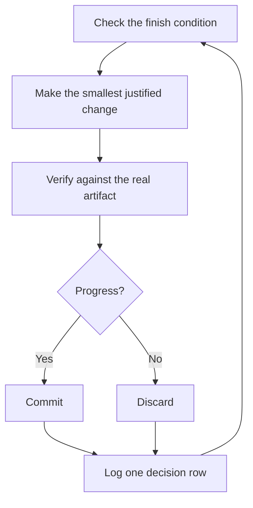

# 在你睡觉时推进工作

这是前面所有内容的回报。一个你能够信任、会验证自身工作的智能体，就是一个你可以放心把艰巨任务交给它、然后走开的智能体。让这种做法安全可靠的不是指望，而是一个可核查的完成条件、一个隔离的 worktree 或云端智能体，以及一份你在早上可以审阅的决策日志。


## 先赢得信任，再开启循环

一个你不信任的循环只会更快地产出未经检查的工作，而且混乱会随着每次迭代不断累积。在让某个循环运行之前，先确认它已经赢得了这份信任：

- 你已经亲手做过一次这项任务，或者看过智能体做，因此你知道做到好是什么样子。
- 智能体拥有你自己会用的工具和信号：验证技能、性能分析器、日志。
- 每个阶段都会证明自己的工作，并在工作未达标时叫停生产线。
- 你已经读过若干次运行记录，并把反复出现的失败转化成了工具、技能或检查项。

只有这四条都满足，才让循环自主运行。在那之前，要在有人看着的情况下运行。

## 隔夜契约

一次良好的交接要包含目标、完成条件、权限和一个应急出口。它不需要很长：

```text
/poteto-mode im going to bed. migrate every caller to the new parser in a fresh worktree off <base>.
done means zero old callers, all parser fixtures pass, old api deleted.
keep a decision log. don't ask me before committing.
/loop until done. if you're truly stuck after a few hours, stop and write up why.
```

逐行看看每一行给你带来了什么：

- "im going to bed" 是一个会话覆盖指令。智能体会停止询问并继续推进。
- "done means..." 把目标转化为每次迭代都能运行的检查项。
- "fresh worktree off `<base>`" 让本次运行不会与你打开的其他任何东西发生冲突。
- "don't ask me before committing" 预先回答了权限问题，否则智能体会卡在那里等你。
- `/loop` 是 Cursor 内置的唤醒机制，不是一个 pstack 技能。[自主运行手册](../../skills/poteto-mode/playbooks/autonomous-run.md)用它基于事件或心跳来重新检查完成条件。
- 应急出口让它在一个真正的死胡同上停下来并写下原因，这胜过八小时创造性地重新解读目标。

由于你会在离开后审阅这项工作，`/poteto-mode` 会通过 [`/figure-it-out`](../../skills/figure-it-out/SKILL.md) 来路由它，后者在写任何代码之前先设计好本次运行的各个阶段，并接入决策日志。

要有意停止一次运行，告诉智能体暂停，或者告诉它你即将离线或重启 Cursor。[安全暂停手册](../../skills/poteto-mode/playbooks/pause-safely.md)会完成或回退当前步骤，提交一个进行中的检查点，并写下一份恢复说明。一个新的会话会通过 Session pickup 手册从这份说明接续工作。说 "keep going"（继续）永远不会触发暂停。

## 循环整夜都在做什么



每次迭代只做一处改动、一次检查、一行日志。没有帮助的改动会被丢弃，而不是留着碰运气。停滞意味着转向，而不是停下；完成条件绝不会悄悄放宽来宣布胜利。

## 早上的审阅

[`/show-me-your-work`](../../skills/show-me-your-work/SKILL.md) 让整次运行变得可审阅。每一行记录时间、阶段、决策、理由、一个证据指针以及结果，存储在一个 TSV 文件 `decisions.tsv` 中（当多次运行共享一个目录时，则是 `.audit/<task-slug>.tsv`）。它默认保留在本地。当工作足够有野心、审阅者需要这条轨迹才能信任结果时，就把它提交进去。

当你回来后，以审阅的形式请求这次运行的汇报：

```text
/show-me-your-work catch me up on what you did last night
```

在技能交回它的总结之前，它会派生一个使用不同模型家族的审阅者来阅读轨迹和运行记录，回复末尾会有一个 Attention 小节，列出值得你仔细审查的内容。先读这一节，再读它指向的日志行。你是在审阅决策，而不是重读一整夜。

如果只是想快速了解状态而非审阅，可在运行该工作的会话中执行 [`/ketchup`](../../skills/ketchup/SKILL.md)。它只读取，用平实的语言告诉你自你上一条消息以来发生了什么变化，并附上工作产生的截图和小图表。然后它会列出每个在等待你的调用，例如一次合并、一次批准，或者在多个选项之间的选择，并附上它的选择、证据和风险，让你仅凭回复就能做决定。

## 当夜晚承载的是一个队列，而非一项任务

上面的契约驱动一项任务达成一个完成条件。有些夜晚承载得更多：一批独立的改动，或者一整个计划。有两个手册和一个技能能把同样的信任机制扩展到这种规模。

[Autopilot-full](../../skills/poteto-mode/playbooks/autopilot-full.md) 会运行一批独立的 PR 直到合并。每个 PR 分配一个 owner 智能体，由它负责从构建到合并的全过程，任何 owner 都不会仅凭自己的判断就合并。一大群全新的验证者会检查 owner 标记代码就绪的提交头。之后的 rebase 或小修只分配一名新的验证者，只有出现新行为或大量新改动才会再次召集完整的验证群体。只有对即将合并的那个补丁给出干净的通过结论，才授权合并：

```text
/poteto-mode full autopilot on this queue. each item is independent. i want them merged by morning.
```

[Autopilot-stack](../../skills/poteto-mode/playbooks/autopilot-stack.md) 就是去掉合并环节的 Autopilot-full。你醒来时看到的是经过验证的 PR，每个都附带它的通过结论，由你自己审阅并落地。一个 PR 只会堆叠在它所依赖的 PR 之上。当你希望在任何合并之前亲自过目这些工作时，选择它而不是 Autopilot-full：

```text
/poteto-mode autopilot these five changes, but don't merge. i'll land them in the morning.
```

一整个计划，例如跨多个包的迁移，没有专属的手册。`/poteto-mode` 会把大型或横切的工作路由到 [`/figure-it-out`](../../skills/figure-it-out/SKILL.md)，后者会为它设计一次严谨的运行：

```text
/poteto-mode migrate every package to the new store. own it until each one is converted and merged. i'll check in twice a day.
```

## 并行运行多个项目

一个 [Cursor Project](https://cursor.com/blog/projects) 为一个协调者智能体提供一条持久的会话线程。协调者不写代码，它指挥子智能体，这些子智能体默认在云端运行，因此即使你的笔记本合上，工作也会继续。用 `/poteto-mode` 作为你给协调者提示的开头，它派生出的子智能体会遵循相应的手册。它启动的每个智能体都会先阅读 [`worker.md`](../../skills/poteto-mode/worker.md)，因此 worker 会坚守启动时的标准，自行决定可逆的调用而不是来问你，并打开可供审阅的 PR。

有几个习惯会有所帮助：

- 给每一块工作独立的 Project，例如一个功能、一次迁移、一轮性能优化，或一次技术债清理。多个 Project 可以并行运行。
- 把相关的会话拖进 Project，已完成的也一并拖入。它们会成为其中每个智能体的上下文。
- 在每个 PR 合并前为它安排一个验证群体，并让 Autopilot-stack 或 Autopilot-full 来推进队列。
- 向协调者索要一份有数据支撑的计划，并要求它在向你提问之前先用原型回答开放性问题。

一条提示就能承载一整个 Project，从调研到执行：

```text
/poteto-mode refactor this repo so its architecture is more agent friendly. use /correct and /architect on past commits and review comments to find the mistakes agents make most here. use /recall for context from past chats. answer open questions with prototypes instead of asking me. come back with a plan backed by real data. once i approve it, run it with autopilot-stack or autopilot-full, and ask me which.
```

## 让循环自行启动

上面每一个循环仍然需要你来启动。一个定时或事件驱动的自动化会省掉这一步。软件维护可以拆分为适合这种方式的阶段：分诊一份报告、复现它、修复它、验证修复。有两条规则能让这样一条生产线保持可信：

- 每个阶段都能叫停生产线。分诊可以判定报告属于预期行为，复现可以无法重现问题，修复者可以判断改动风险过高。这些结果中的每一种都是有用的，因为它们阻止糟糕的工作进入下一阶段——在那里撤销它的代价更高。
- 每个阶段都要交接证据。复现附上出问题状态的截图和视频，修复附上前后对比的证明。这样一来，人类就能在读一行代码之前，先确认智能体修对了东西。

pstack 将其作为一个休眠的[自动化包](../../automations/benny/README.md)提供，用于 Slack 的 issue 报告。其中一个自动化对每份报告进行分诊，另一个复现已确认的 bug，并可能准备一份小的草稿修复。让一个智能体指向它的 [`FOR_AGENTS.md`](../../automations/benny/FOR_AGENTS.md) 并指定目标仓库即可完成设置。

**陷阱：** 时长不是完成条件。"做这件事 4 小时"没有给智能体任何可核查的东西，你醒来得到的会是四小时的忙碌，而不是一个结果。给 `/loop` 一个能通过或失败的断言。

下一篇：[用原则名称来引导](./08-principles.md)。
