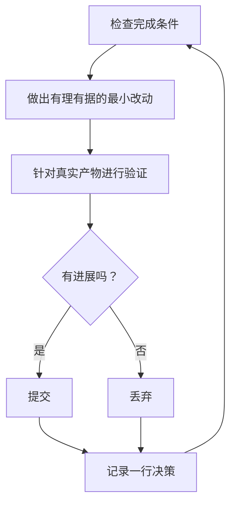

# 睡觉时也能推进工作

这是前面所有付出换来的回报。一个你能信任、会自己验证工作的智能体，才是一个你可以放手让它独自啃硬任务的智能体。让这件事安全可靠的不是运气，而是一套可校验的完成条件、一个隔离的工作树或云端智能体，以及一份你早上会审查的决策日志。


## 在开启循环前先赢得信任

一个你不信任的循环，只会更快地产出没经过校验的工作，而且每迭代一次，乱子就更大一圈。在放手让它运行之前，先确认它已经赢得了这份信任：

- 你已经亲手做过一次这个任务，或者看过智能体做过，所以你知道做到什么程度才算好。
- 智能体手上有你自己也会用的工具和信号：验证技能、性能分析器、日志。
- 每个阶段都会证明自己的工作，一旦工作不达标就能叫停整条流水线。
- 你读过几份对话记录，把反复出现的失败转化成了工具、技能或校验项。

只有这四条都成立，才让循环自动运行。在此之前，盯着它跑。

## 夜间运行的约定

一次好的交接包含目标、完成条件、权限和一条退路。它不需要写得很长：

```text
/poteto-mode 我要睡了。在基于 <base> 新建的工作树里，把所有调用方迁移到新的解析器。
完成的标准是：旧调用方清零，所有解析器测试样本都通过，旧 api 删除。
记一份决策日志。提交前不用问我。
/loop 一直跑到完成。如果卡了几个小时实在过不去，就停下来把原因写清楚。
```

逐行看看每一行为你换来什么：

- 「我要睡了」是一次会话覆盖指令。智能体不再反复确认，直接继续往下做。
- 「完成的标准是……」把目标变成了每次迭代都能跑的校验项。
- 「基于 `<base>` 新建的工作树」让这次运行不会和你打开的其他东西冲突。
- 「提交前不用问我」提前回答了权限问题，否则智能体就会卡在这里等你。
- `/loop` 是 Cursor 内置的唤醒机制，不是 pstack 技能。[自动运行行动手册](../../skills/poteto-mode/playbooks/autonomous-run.md) 用它来在事件或心跳时重新检查完成条件。
- 这条退路让它能在真正走投无路时停下来写清原因，这比花八小时绞尽脑汁重新解读目标强得多。

因为你离开后还要审查这些工作，`/poteto-mode` 会把它交给 [`/figure-it-out`](../../skills/figure-it-out/SKILL.md) 来处理，在写代码之前先设计好这次运行的各个阶段，并接上决策日志。

要主动叫停一次运行，就告诉智能体暂停，或者告诉它你马上要下线、要重启 Cursor。[安全暂停行动手册](../../skills/poteto-mode/playbooks/pause-safely.md) 会完成或退出当前步骤，提交一个进行中的检查点，并写一份恢复说明。新开一个会话后，智能体会通过会话接续行动手册从这份说明接着干。说「继续」永远不会触发暂停。

## 循环整晚都在做什么



每次迭代都是一次改动、一次校验、一行记录。没起作用的改动会被丢弃，不会留在那里搭便车。遇到平台期意味着要转向，而不是停下；完成条件也绝不会悄悄放宽来宣布胜利。

## 早上的审查

[`/show-me-your-work`](../../skills/show-me-your-work/SKILL.md) 让这次运行变得可审查。每行记录时间、阶段、决策、理由、证据指针和结果，存成一个 TSV 文件 `decisions.tsv`（当多个运行共用一个目录时，则存为 `.audit/<task-slug>.tsv`）。它默认只保存在本地。当工作量大到审查者需要这份线索才能相信结果时，就把它提交上去。

回来后，用审查的形式让它汇报这次运行：

```text
/show-me-your-work 跟我说说你昨晚做了什么
```

在这个技能交回它的总结之前，它会派生一个来自不同模型家族的审查者，去读这份线索和对话记录；回复的末尾会有一个「注意」部分，列出值得你细看的地方。先读这一部分，再读它指向的那些日志行。你审查的是决策，不是把整晚的内容重新读一遍。

如果你只是想快速看看状态、不做审查，就在运行这项工作的那个会话里执行 [`/ketchup`](../../skills/ketchup/SKILL.md)。它只读不写，用大白话告诉你自你上条消息以来改了什么，还会附上这项工作产出的截图和小图。然后它会列出每一件等你拍板的事，比如一次合并、一次批准，或者在几个选项之间做选择，并给出它的建议、证据和风险，这样你光看回复就能做决定。

## 当夜里等着的是队列，而不是一项任务

上面的约定是把一项任务推到一个完成条件。有些夜晚等着的东西更多：一串相互独立的改动，或者一整个项目计划。两个行动手册和一个技能把同样的信任机制放大到更大范围。

[Autopilot-full](../../skills/poteto-mode/playbooks/autopilot-full.md) 会把一串相互独立的 PR 一路跑到合并。每个 PR 配一个负责的智能体，从构建一路带到合并，但任何负责者都不能仅凭自己的结论就执行合并。一群全新的验证者会检查负责者交出的、可以合并的代码版本。之后的变基或小修只再叫一个全新的验证者；只有出现新行为或大段新改动，才会再次召集整群验证者。只有当即将合并的那个补丁拿到干净的结论，才允许合并：

```text
/poteto-mode 对这个队列开启完整自动运行。每一项都相互独立。我要它们早上之前都合并掉。
```

[Autopilot-stack](../../skills/poteto-mode/playbooks/autopilot-stack.md) 就是去掉合并环节的 Autopilot-full。你醒来时会看到一堆已经验证过的 PR，每个都带着自己的结论，然后由你自己审查并落地。一个 PR 只会叠在它所基于的那个 PR 之上。当你想在任何东西合并前亲自过目时，就选它而不是 Autopilot-full：

```text
/poteto-mode 自动运行这五项改动，但不要合并。我早上自己来落地。
```

一整个项目计划，比如跨多个包的迁移，并没有专属的行动手册。`/poteto-mode` 会把大型或横切的工作交给 [`/figure-it-out`](../../skills/figure-it-out/SKILL.md)，由它为这项工作设计一次严谨的运行：

```text
/poteto-mode 把每个包都迁移到新的存储。一扛到底，直到每一个都转换完并合并。我每天会来看两次。
```

## 并行运行多个项目

[Cursor 项目](https://cursor.com/blog/projects) 给一个协调智能体提供一条持久的会话线。协调智能体不写代码。它指挥子代理，子代理默认在云端运行，所以你合上笔记本后工作仍在继续。你给协调智能体的提示词要以 `/poteto-mode` 开头，它派生的子代理会遵循那些行动手册。它启动的每个智能体都会先读 [`worker.md`](../../skills/poteto-mode/worker.md)，这样这些执行者就能守住启动时的标准，自己决定可逆的操作而不是来问你，并且开出随时可审查的 PR。

有几个习惯会帮上忙：

- 给每一摊工作配一个自己的项目，比如一个功能、一次迁移、一轮性能攻坚，或者一次技术债清理。好几个项目可以并排跑。
- 把相关的会话拖进这个项目，已完成的也算。它们会变成项目里每个智能体的上下文。
- 每个 PR 在合并前都配一群验证者，让 Autopilot-stack 或 Autopilot-full 来推动整条队列。
- 让协调智能体给出有数据支撑的计划，并要求它在问你之前，先用原型回答那些悬而未决的问题。

一条提示词就能撑起整个项目，从调研一路到执行：

```text
/poteto-mode 重构这个仓库，让它的架构对智能体更友好。用 /correct 和 /architect 翻一翻过去那些提交和评审意见，找出智能体在这里最常犯的错。用 /recall 从以前的会话里找上下文。有悬而未决的问题就用原型来回答，别来问我。带着一份有真实数据支撑的计划回来。我批准之后，用 autopilot-stack 或 autopilot-full 来跑，并问我用哪一个。
```

## 让循环自己启动

上面每个循环都还得等你来启动。定时或事件驱动的自动化省掉了这一步。软件维护可以拆成几个正适合这么干的阶段：分拣报告、复现问题、修复、验证修复。有两条规则让这样一条流水线值得信任：

- 每个阶段都能叫停流水线。分拣阶段可以判定这份报告说的是预期行为，复现阶段可能复现不出来，修复者也可能判断这个改动风险太大。这些结果都有用，因为它们能挡住糟糕的工作流向下一阶段——到了那里，撤销的代价更高。
- 每个阶段都要交出证据。复现阶段附上出问题状态的截图和视频，修复阶段附上修复前后的证据。这样人在读一行代码之前，就能先确认智能体修对了东西。

pstack 把这做成了一个休眠状态的[自动化包](../../automations/benny/README.md)，专门处理 Slack 上的问题报告。一个自动化负责分拣每份报告，另一个复现已确认的 bug，并可能准备一份小小的修复草稿。让一个智能体去看它的 [`FOR_AGENTS.md`](../../automations/benny/FOR_AGENTS.md)，再告诉它目标仓库是哪个，就能把它搭起来。

**常见误区：** 时长不是完成条件。「这件事做 4 小时」没给智能体任何可校验的东西，你醒来只会看到忙了四个小时，而不是一个结果。给 `/loop` 一个能判定通过或失败的谓词。

下一篇：[用原则名称来引导](./08-principles.md)。
