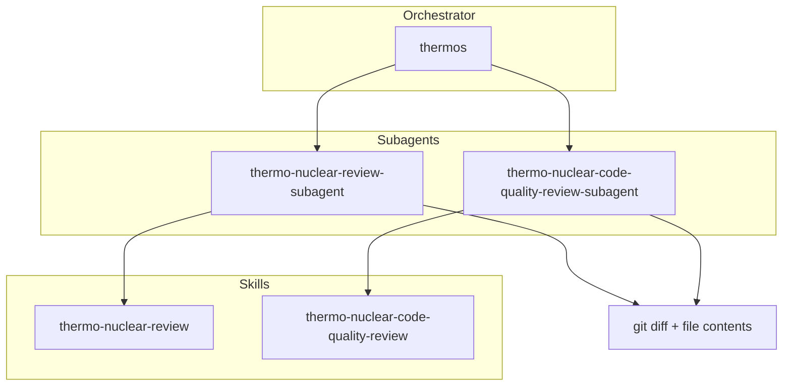

# Thermos 插件

面向 Cursor agent 的热核级分支审查：深度正确性与安全审计、严苛的可维护性评分标准，以及并行子 agent 编排。

## 安装

```bash
/add-plugin thermos
```

## 架构



## Skills

| Skill | 描述 |
|:------|:------------|
| `thermo-nuclear-review` | 深度分支审计（缺陷、破坏性变更、安全、开发体验、功能开关泄漏）。 |
| `thermo-nuclear-code-quality-review` | 严格的可维护性审计（code-judo、千行规则、意大利面代码、边界）。 |
| `thermos` | 并行运行两个审查子 agent 并综合汇总发现。 |

## Agents

| Agent | 描述 |
|:------|:------------|
| `thermo-nuclear-review-subagent` | 用于深度审查评分标准的任务子 agent（以 diff 为范围）。 |
| `thermo-nuclear-code-quality-review-subagent` | 用于代码质量评分标准的任务子 agent（以 diff 为范围）。 |

## 典型用法

**双重审查（thermos）：**

1. 收集 `git diff main...HEAD` 以及变更文件的完整内容。
2. 在一条消息中调用两个子 agent，并设置 `run_in_background: true`。
3. 综合去重并按优先级排序，汇总审查发现。

**单个 skill：** 在主 agent 中调用 `thermo-nuclear-review` 或 `thermo-nuclear-code-quality-review`，或在收集 diff 上下文后调用与之匹配的子 agent。

## 从 cursor-team-kit 迁移

`cursor-team-kit` 此前仅包含 `thermo-nuclear-code-quality-review`。该 skill 和 agent 现在归属于 **Thermos**，与深度审查及 `thermos` 一同提供。安装本插件时，请从 team-kit 中移除旧的 thermo 条目，以避免重复。

## 许可证

MIT
